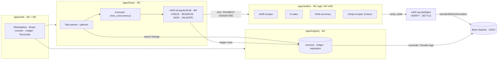
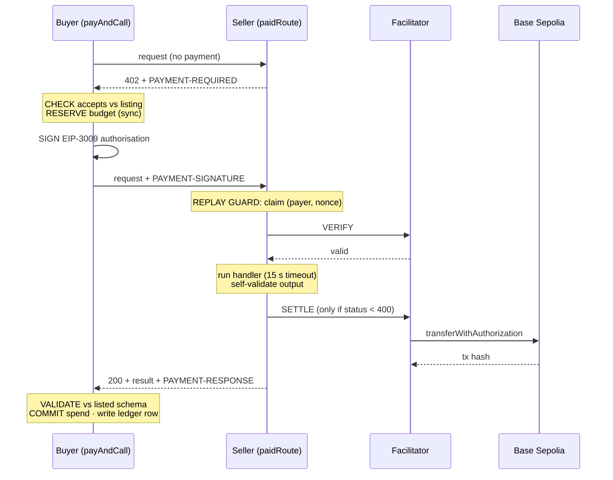

# PRD: Pay-per-Call Agent Economy

| | |
|---|---|
| **Status** | Draft v0.1 |
| **Date** | 16 Oct 2026 |
| **Owner** | Member 1 (Lead) |
| **Event** | 24-hour hackathon: live demo, judge test pack, viva |
| **Network** | Base Sepolia (`eip155:84532`). **Testnet only.** Any mainnet transaction disqualifies the team. |

---

## Contents

- [1. Summary](#1-summary)
- [2. Problem](#2-problem)
- [3. Goals and non-goals](#3-goals-and-non-goals)
- [4. Users](#4-users)
- [5. Functional requirements](#5-functional-requirements)
  - [5.1 Registry (FR-REG)](#51-registry-fr-reg)
  - [5.2 Sellers (FR-SEL)](#52-sellers-fr-sel)
  - [5.3 Buyer agent (FR-BUY)](#53-buyer-agent-fr-buy)
  - [5.3.1 Seller selection rules and fallback (FR-RULE, FR-FB)](#531-seller-selection-rules-and-fallback-fr-rule-fr-fb)
  - [5.4 Ledger and reconciliation (FR-LED)](#54-ledger-and-reconciliation-fr-led)
  - [5.5 Web UI (FR-UI)](#55-web-ui-fr-ui)
- [6. Non-functional requirements](#6-non-functional-requirements)
  - [6.1 Payment-safety invariants (must always hold)](#61-payment-safety-invariants-must-always-hold)
  - [6.2 Security and key hygiene](#62-security-and-key-hygiene)
  - [6.3 Correctness](#63-correctness)
  - [6.4 Performance and reliability](#64-performance-and-reliability)
  - [6.5 Rules compliance](#65-rules-compliance)
- [7. Architecture](#7-architecture)
  - [7.1 Components](#71-components)
  - [7.2 One paid call: where payments are checked, signed, verified and settled](#72-one-paid-call-where-payments-are-checked-signed-verified-and-settled)
  - [7.3 Services and ports](#73-services-and-ports)
  - [7.4 Repository layout and ownership](#74-repository-layout-and-ownership)
- [8. Data model](#8-data-model)
- [9. API contracts](#9-api-contracts-frozen-at-h1-changes-go-through-a-pr-reviewed-by-the-owner)
  - [9.1 Shared types (`packages/shared`, M1)](#91-shared-types-packagesshared-m1)
  - [9.2 `x402-kit` interface (M4: stubs at H1, real by H8)](#92-x402-kit-interface-m4-stubs-at-h1-real-by-h8)
  - [9.3 Registry API (M1, port 4000)](#93-registry-api-m1-port-4000)
  - [9.4 Buyer API (M1, port 4200)](#94-buyer-api-m1-port-4200)
  - [9.5 Seller endpoints (M1 logic)](#95-seller-endpoints-m1-logic)
- [10. Acceptance tests (the judges' tests)](#10-acceptance-tests-the-judges-tests)
- [11. Team and ownership](#11-team-and-ownership)
- [12. Work distribution](#12-work-distribution)
  - [Member 1 (Lead): Backend, Agents, Deployment](#member-1-lead-backend-agents-deployment)
  - [Member 2: Frontend UI](#member-2-frontend-ui)
  - [Member 3: Frontend Implementation](#member-3-frontend-implementation)
  - [Member 4: Wallet, x402](#member-4-wallet-x402)
- [13. Hand-offs and dependencies](#13-hand-offs-and-dependencies)
- [14. Git workflow](#14-git-workflow)
  - [14.1 Branches](#141-branches)
  - [14.2 Day-to-day flow](#142-day-to-day-flow)
  - [14.3 Pull request rules](#143-pull-request-rules)
  - [14.4 Checkpoint merges to `main`](#144-checkpoint-merges-to-main)
  - [14.5 Conflict hotspots](#145-conflict-hotspots)
  - [14.6 Secrets in git](#146-secrets-in-git)
- [15. Timeline (24 h)](#15-timeline-24-h)
- [16. Risks](#16-risks)
- [17. Open questions](#17-open-questions)
- [18. Definition of done](#18-definition-of-done)
- [Appendix A: Example tasks (each uses all three categories)](#appendix-a-example-tasks-each-uses-all-three-categories)
- [Appendix B: Wallets (fill in at H1)](#appendix-b-wallets-fill-in-at-h1)

---

## 1. Summary

A marketplace where AI agents hire other agents and pay **per request** in testnet USDC over **x402 v2** (HTTP `402 Payment Required`). Sellers list scraping, data and inference services in a registry. A buyer agent takes a plain-language task and a budget, picks sellers by reputation and price, pays each call, checks every result against its schema, and explains what it bought. Every paid call settles on-chain with its own transaction hash, and a ledger reconciles against the chain to the last unit.

## 2. Problem

Agents can do useful work for each other but have no safe, instant way to pay each other a fraction of a cent per request. Cards, API keys, subscriptions and invoices all assume a human. x402 gives us the wire protocol. We have to build the **market** on top of it: discovery, money safety, quality control and an auditable record.

An autonomous buyer can lose money in five ways. This product must close all five:

1. **Overspending**, especially with parallel calls.
2. **Overcharging**: the 402 asks more than the listed price, or names a different token, network or payTo.
3. **Replay**: one signed payment used more than once.
4. **Paying for nothing**: the seller errors, times out or breaks its own schema.
5. **Paying for junk**: the output arrives but is invalid.

## 3. Goals and non-goals

**Goals**

| ID | Goal |
|---|---|
| G1 | Pass every judged test (section 10) on public HTTPS URLs |
| G2 | Enforce all five payment-safety invariants in code (section 6.1) |
| G3 | Interoperate both ways with unmodified x402 v2 SDK clients and sellers |
| G4 | Make every payment explainable: what was bought, from whom, why, at what cost |
| G5 | Reconcile the ledger with the chain to the last unit |
| G6 | Keep zero secrets in the repo, git history, web bundle or logs |

**Non-goals**

- Mainnet, real funds or any production payment flow.
- User accounts or login for humans.
- General web scraping. We scrape only the `toscrape.com` sandboxes.
- Mobile apps.
- A second network. Solana Devnet is a stretch goal only.

## 4. Users

| Persona | What they need |
|---|---|
| **Buyer agent (Scout) and its operator** | Give a task and a budget. Get a correct result, a clear cost breakdown, and a guarantee the agent never overspends or pays twice. |
| **Seller operator** | List a service, get paid per call with no invoicing, and build a reputation. |
| **Judge / auditor** | Register reference sellers (honest, overpriced, wrong payTo, junk). Run the tests, and compare the ledger with Basescan. |

---

## 5. Functional requirements

Priority: **P0** = required by the brief or judged · **P1** = strong polish · **P2** = stretch (extra credit)

### 5.1 Registry (FR-REG)

| ID | Pri | Requirement |
|---|---|---|
| FR-REG-1 | P0 | A listing has: `name`, `category` (`data` \| `inference` \| `scraping`), `endpoint` (HTTPS), `method`, `price` (USDC), `network`, `asset`, `payTo`, `inputSchema`, `outputSchema`, `description`. |
| FR-REG-2 | P0 | Search by `category`, `maxPrice` and `minSuccessRate` through the HTTP API. |
| FR-REG-3 | P0 | A web page with the same search, showing reputation columns. |
| FR-REG-4 | P0 | `POST /api/services` registers a listing. Reject any listing with: network ≠ `eip155:84532`, asset ≠ testnet USDC, price > 0.10 USDC, invalid JSON Schemas, or a non-HTTPS endpoint (localhost is allowed in dev). |
| FR-REG-5 | P0 | Each seller's reputation shows success rate, median latency and price, from the UI and the API. |
| FR-REG-6 | P1 | New sellers start at a neutral prior (Beta prior: 2 successes, 1 failure), not 0% or 100%. Judges' reference sellers can then be picked. |
| FR-REG-7 | P2 | Services are also described through the x402 Bazaar discovery extension. |

### 5.2 Sellers (FR-SEL)

| ID | Pri | Requirement |
|---|---|---|
| FR-SEL-1 | P0 | At least three sellers, one per category: **shelf-scraper** (scraping), **fx-rates** (data), **hindi-summary** (inference). |
| FR-SEL-2 | P0 | Each paid route answers `402` with a `PAYMENT-REQUIRED` header: x402 v2, scheme `exact`, `eip155:84532`, USDC, its own `payTo`, `maxTimeoutSeconds: 60`. Base Sepolia is the first entry in `accepts`. |
| FR-SEL-3 | P0 | Input is validated **before** the 402. Bad input gets a `400`, so nobody pays for a malformed request. |
| FR-SEL-4 | P0 | **Replay guard:** the seller claims `(payer, nonce)` atomically (SQLite `UNIQUE`) before verifying. Any repeat, sequential or parallel, gets `409`, and the handler never runs for it. |
| FR-SEL-5 | P0 | **No service, no charge:** a handler error, a timeout (15 s → `504`), or output that breaks the seller's own schema (`500`) returns an error and is **not settled**. |
| FR-SEL-6 | P0 | On success the seller returns `200` with the result and a `PAYMENT-RESPONSE` header holding the tx hash. |
| FR-SEL-7 | P0 | An unmodified x402 v2 client (`@x402/fetch`) can pay every seller. |
| FR-SEL-8 | P0 | The scraper only hits `*.toscrape.com` and obeys `robots.txt`. One call returns one catalogue page, *including each book's description*: the seller fetches the product pages itself and caches them. |
| FR-SEL-9 | P1 | A **chaos seller** (`cheap-scraper`), a test fixture with env-selected modes: `honest`, `overprice`, `wrong-payto`, `junk`, `fail`. It is labelled as a fixture in the registry. |
| FR-SEL-10 | P2 | **Agent chain:** a `book-report` seller that hires the other sellers and pays them from what it earns. |
| FR-SEL-11 | P2 | Metered pricing for inference (pay per token). |

### 5.3 Buyer agent (FR-BUY)

| ID | Pri | Requirement |
|---|---|---|
| FR-BUY-1 | P0 | Input: `task` (plain language), `budget` (USDC decimal string), `max_concurrency` (≥ 1, supports ≥ 3), optional `only_sellers` / `prefer_sellers`. |
| FR-BUY-2 | P0 | An LLM parses the task into a structured spec, with output checked against a JSON Schema and a regex fallback parser. Plain code then plans the calls as a DAG and estimates the cost **before** spending. |
| FR-BUY-3 | P0 | Picks sellers with the selection rules R1–R8 and falls back down the ladder FB-1–FB-5 (section 5.3.1). Every purchase records the rule that chose it. |
| FR-BUY-4 | P0 | **Price check:** keeps only `accepts` entries that exactly match the listing (scheme, network, asset, payTo case-insensitive, amount ≤ listed). If none match it refuses, signs nothing and pays nothing. |
| FR-BUY-5 | P0 | **Budget guard:** reserves the amount synchronously *before* signing. `spent + reserved ≤ budget` holds at any concurrency. |
| FR-BUY-6 | P0 | Validates every response against the listing's `outputSchema`. A failure is recorded as `paid_output_rejected`: the output is not used, reputation drops, and the buyer goes to the next-ranked seller if the budget allows. |
| FR-BUY-7 | P0 | Combines results and explains, per call: what, from whom, why that seller, and cost. The LLM writes the explanation **from ledger rows only**. |
| FR-BUY-8 | P0 | When the budget is short, the buyer stops before going over and reports the shortfall and the steps left ("needs 0.008 USDC more for: summaries 2–3"). |
| FR-BUY-9 | P0 | Pays unmodified x402 v2 sellers. |
| FR-BUY-10 | P0 | **Ambiguous outcome:** if the call was signed and sent but no clear answer came back, the reservation stays held until `validBefore` passes. The buyer then checks USDC `authorizationState(buyer, nonce)` on-chain and finalises the row. |
| FR-BUY-11 | P2 | Spending policies per seller or category, with human approval above a threshold. The same flow handles "ask for more budget". |

### 5.3.1 Seller selection rules and fallback (FR-RULE, FR-FB)

Implemented in `apps/buyer/src/selection.ts` (rules) and `apps/buyer/src/executor.ts` (ladder). Every decision is traced: the explanation shows, per purchase, which rule chose the seller and which rules skipped the others.

| ID | Rule | Kind | Requirement |
|---|---|---|---|
| FR-RULE-1 | Caller intent | hard | `only_sellers` restricts a category (only where it names a seller in that category); `prefer_sellers` are tried first in the given order; test fixtures are used only when named. |
| FR-RULE-2 | Contract fit | hard | Same category; the seller's `inputSchema` accepts the request (Ajv, trying the request variants from most to least specific); its `outputSchema` promises every needed field. A preferred seller skips the output promise and is checked on arrival. |
| FR-RULE-3 | Safe listing | hard, never relaxed | `eip155:84532`, testnet USDC, 1 to 100000 units, payTo a real address that is neither zero nor the buyer's own wallet, https endpoint (http only on loopback). Repeats the registry's checks. |
| FR-RULE-4 | Affordability | soft | Price > remaining + held: skip. Price > remaining but ≤ remaining + held: rank after sellers that fit now. |
| FR-RULE-5 | Fair price | soft | Skip a seller priced over 3× the median of the usable sellers (passing R4 and R6, not on cool-down) when another usable seller is fairly priced. |
| FR-RULE-6 | Trust floor | soft | ≥ 5 counted calls and posterior success < 50%: skip. ≥ 3 consecutive recent failures: cool-down (ranked last). Struck earlier in this task: skip. |
| FR-RULE-7 | Best value | score | Score = price ÷ P(success) + 100 units per second of median latency. P(success) = Beta(successes+2, failures+1) mean minus 1 standard deviation (floor 5%). Ties: latency, then price, then id. |
| FR-RULE-8 | Spread near-ties | tie-break | Parallel steps of the same kind rotate, by step position, across sellers within 10% of the best score. |

Caller-preferred sellers are exempt from FR-RULE-5 and FR-RULE-6 (the rule is noted, not applied). All thresholds are configurable (`MarketOptions.selection`).

| ID | Fallback | Requirement |
|---|---|---|
| FR-FB-1 | Next-ranked seller | After a failed attempt, try the next candidate. Dishonest behaviour (402 over price or with another payTo, schema-breaking output, settling after a reported failure) strikes the seller for the task. An operational failure (5xx, unreachable, no answer) skips it for this step and strikes it on the second. A 4xx about this particular input never counts. |
| FR-FB-2 | Relax soft rules | When no seller passes every rule, offer the best of those that pass R1–R3, name the relaxed rule(s) in the event log and the explanation. R1–R3 are never relaxed. |
| FR-FB-3 | Budget | Wait (up to 100 s) while money is only held by an unsettled payment; otherwise mark the step blocked, keep the partial answer, report the exact top-up. |
| FR-FB-4 | Probe unproven sellers | A seller without a good record (< 3 calls or < 80% success) gets one call at a time until it delivers. |
| FR-FB-5 | Graceful give-up | After 4 sellers, or when none is left, the step fails; the answer names the gap and the task ends `partial`. |

### 5.4 Ledger and reconciliation (FR-LED)

| ID | Pri | Requirement |
|---|---|---|
| FR-LED-1 | P0 | One row per **attempted** call: time, buyer, seller, service, listed, asked, paid, tx hash, explorer link, status, reason, latency. |
| FR-LED-2 | P0 | Statuses: `paid` · `paid_output_rejected` · `refused` · `failed_not_charged`. A budget block is `refused` with reason `budget`. |
| FR-LED-3 | P0 | Each tx hash links to `https://sepolia.basescan.org/tx/<hash>`. |
| FR-LED-4 | P0 | **Reconcile:** the sum of `paid` + `paid_output_rejected` equals the USDC `Transfer` events out of the buyer wallet since the session's start block, to the unit. The tx-hash sets are also compared in both directions. |
| FR-LED-5 | P1 | Live updates (SSE). |
| FR-LED-6 | P1 | A per-row on-chain confirmation that the receipt's Transfer log matches buyer → payTo for the exact amount. |

### 5.5 Web UI (FR-UI)

| ID | Pri | Page | Contents |
|---|---|---|---|
| FR-UI-1 | P0 | **Marketplace** | Filters (category, max price, min success rate). Table: name, category, price (USDC + units), payTo, success %, median latency, calls. |
| FR-UI-2 | P0 | **Service detail** | Description, input/output schema viewer, reputation, recent calls. |
| FR-UI-3 | P0 | **Register service** | Form for every listing field, plus JSON Schema editors with client-side validation. |
| FR-UI-4 | P0 | **Buyer console** | Task, budget and max_concurrency inputs, optional seller pins. Live plan and cost estimate, per-call progress, a budget meter (spent / reserved / remaining), final answer and explanation. |
| FR-UI-5 | P0 | **Ledger** | Every attempted call with status badges and explorer links. Filter by session and status. Totals. |
| FR-UI-6 | P0 | **Reconcile panel** | Ledger total vs chain total, the difference, and unmatched hashes. |
| FR-UI-7 | P1 | **Wallets** | All addresses with explorer links and USDC balances (public data only). |

---

## 6. Non-functional requirements

### 6.1 Payment-safety invariants (must always hold)

| ID | Invariant | Enforced in |
|---|---|---|
| INV-1 | `spent + reserved ≤ budget` at every moment, at any `max_concurrency` | Buyer, `Budget.reserve()` (synchronous) |
| INV-2 | Nothing is signed unless the asked amount ≤ listed and asset, network and payTo all match | Buyer, `payAndCall` price check |
| INV-3 | One authorisation gives exactly one response and one transfer | Seller, replay guard |
| INV-4 | No settlement unless the handler succeeded within its timeout and its output passed the seller's own schema | Seller, `paidRoute` (the x402 v2 middleware settles only when status < 400) |
| INV-5 | Invalid output is never used and always lowers reputation | Buyer, `payAndCall` + registry |

### 6.2 Security and key hygiene
- **Only the buyer holds a private key** (plus the agent-chain seller, if built). Sellers need only a public `payTo`, because the facilitator pays gas.
- Keys live in `.env` (git-ignored) on the machine that runs them. Never paste keys in team chat. Each member uses **their own dev wallet** locally. The judged buyer key exists only on the deploy machine.
- Logs pass through a redactor that removes the value of every secret environment variable (`*PRIVATE_KEY*`, `*API_KEY*`, `*TOKEN*`, `*SECRET*`), 65-byte signatures (an unused EIP-3009 authorisation is replayable), Google (Gemini) and Anthropic API keys. Transaction hashes and nonces share the `0x` + 64-hex shape of a private key, so redaction matches known secret values rather than that pattern.
- The web bundle contains only public config (`VITE_PUBLIC_*`). The build output is scanned for secrets.
- gitleaks runs as a pre-commit hook and in CI, over the working tree and the full history.
- **Mainnet kill-switch:** every service checks at startup that `NETWORK === "eip155:84532"` and that the RPC `chainId === 84532`, and exits otherwise.
- A leaked key means a **burned wallet**: create a new one and move funds. Rewriting history is not enough.

### 6.3 Correctness
- All amounts are integer units (`bigint` in code, decimal strings in JSON). No floats anywhere in the money path.
- `"0.050"` is parsed exactly to `50000n`.

### 6.4 Performance and reliability
- Scraper p50 < 3 s when cached. Example task end to end < 60 s.
- Sellers and the registry stay reachable over public HTTPS for the whole judging window, with `/health` on every service and auto-restart.
- `FACILITATOR_URL` is configurable, with a self-hosted facilitator as backup.

### 6.5 Rules compliance
- At most 0.10 USDC per call, enforced at registration and at seller startup.
- x402 v2 on every judged path.
- Scraping limited to `toscrape.com`, respecting `robots.txt`.

---

## 7. Architecture

### 7.1 Components



### 7.2 One paid call: where payments are checked, signed, verified and settled



| Step | Where | Owner |
|---|---|---|
| Price, token, network, payTo check | Buyer, before signing | M4 |
| Budget reservation | Buyer, before signing | M4 |
| Signing | Buyer, in process; the key never leaves it | M4 |
| Replay guard | Seller, before verify | M4 |
| Verification | Facilitator, called by the seller | M4 |
| Service delivery and self-validation | Seller, before settlement | M1 |
| Settlement | Facilitator, on-chain | M4 |
| Result validation, fallback, reputation | Buyer and registry | M4 + M1 |

### 7.3 Services and ports

| Service | Port (dev) | Public hostname (judging) |
|---|---|---|
| Registry API + web build | 4000 | `app.<domain>` |
| Buyer agent API | 4200 | `buyer.<domain>` |
| shelf-scraper | 4101 | `scraper.<domain>` |
| fx-rates | 4102 | `fx.<domain>` |
| hindi-summary | 4103 | `summary.<domain>` |
| cheap-scraper (chaos) | 4199 | `chaos.<domain>` |
| Web dev server | 5173 | n/a |

Each service gets its own subdomain on one **named** cloudflared tunnel (or an ngrok static domain), so URLs survive restarts. Express runs with `trust proxy` and a `PUBLIC_URL` per service, so `resource.url` in each 402 is the public HTTPS URL.

### 7.4 Repository layout and ownership

```
.
├── apps/
│   ├── registry/           M1   API, reputation, ledger store, serves web build
│   ├── buyer/              M1   parser, planner, executor, explanation, tasks API
│   ├── sellers/
│   │   ├── scraper/        M1   handler logic (uses x402-kit paidRoute)
│   │   ├── data/           M1
│   │   ├── inference/      M1
│   │   └── chaos/          M4   test fixture
│   └── web/                M2 (components, styles) · M3 (api, hooks, pages)
├── packages/
│   ├── shared/             M1   types, JSON Schemas, unit helpers
│   └── x402-kit/           M4   payAndCall, Budget, paidRoute, replay guard, chain reads
├── tests/                  M4   judged test pack (M1 co-owns happy path + budget)
├── docs/                   all  PRD, architecture, demo script
├── docker-compose.yml      M1
├── .env.example            M4
└── README.md               M1
```

Stack: TypeScript, Node 22, npm workspaces, Express, SQLite, Ajv, viem, and `@x402/express`, `@x402/evm`, `@x402/core`, `@x402/fetch` (exact versions pinned). Web: Vite, React, TypeScript, Tailwind (proposed, for M2 and M3 to confirm).

---

## 8. Data model

**`services`** (registry)
`id` · `seller_id` · `name` · `category` · `description` · `endpoint` · `method` · `price_units` · `network` · `asset` · `pay_to` · `input_schema` (JSON) · `output_schema` (JSON) · `is_fixture` · `created_at`

**`sessions`** (registry)
`id` · `buyer` · `start_block` · `created_at`

**`ledger`** (registry)
`id` · `session_id` · `task_id` · `created_at` · `buyer` · `seller_id` · `service_id` · `listed_units` · `asked_units` · `paid_units` · `status` · `reason` · `tx_hash` · `nonce` · `valid_before` · `latency_ms` · `onchain_confirmed`

**`nonces`** (each seller, own SQLite)
`payer` · `nonce` · `state` (`claimed` \| `settled` \| `failed`) · `tx_hash` · `created_at`, with `PRIMARY KEY (payer, nonce)`

**Reputation** (a view over `ledger`, per seller)
- `success_rate` = (paid + 2) / (calls_counted + 3).
- Counted calls are `paid`, `paid_output_rejected`, seller-side `failed_not_charged`, and `refused` for a price, payTo, token or network mismatch.
- A `refused` for **budget** reasons is not the seller's fault and is not counted.
- `median_latency_ms` is taken over `paid` calls. `price_units` comes from the listing.

---

## 9. API contracts (frozen at H1; changes go through a PR reviewed by the owner)

### 9.1 Shared types (`packages/shared`, M1)

```ts
type Category = "data" | "inference" | "scraping";
type LedgerStatus = "paid" | "paid_output_rejected" | "refused" | "failed_not_charged";

interface Listing {
  id: string; sellerId: string; name: string; category: Category;
  description: string; endpoint: string; method: "GET" | "POST";
  priceUnits: string;            // "5000" = 0.005 USDC
  network: "eip155:84532";
  asset: string;                 // 0x036CbD53842c5426634e7929541eC2318f3dCF7e
  payTo: `0x${string}`;
  inputSchema: object; outputSchema: object;
  isFixture?: boolean;
}

interface LedgerRow {
  id: string; time: string; sessionId: string; taskId: string;
  buyer: string; sellerId: string; serviceId: string;
  listedUnits: string; askedUnits: string | null; paidUnits: string;
  status: LedgerStatus; reason: string | null;
  txHash: string | null; explorerUrl: string | null;
  latencyMs: number; onchainConfirmed: boolean | null;
}
```

### 9.2 `x402-kit` interface (M4: stubs at H1, real by H8)

```ts
// Units
toUnits(usdc: string): bigint;            // exact; "0.050" -> 50000n
fromUnits(u: bigint): string;

// Buyer side
new Budget(total: bigint)            // reserve(amount) -> Reservation | null (sync), commit, release, snapshot, waitForChange
new Buyer({ account, sessionId?, ledger?: LedgerSink[], chain?, clock? })
buyer.payAndCall({ listing, input, budget, taskId?, timeoutMs? }): Promise<CallOutcome>
  // CallOutcome = { row: LedgerRow, output?, validationErrors?, finalized: Promise<LedgerRow> }
buyer.drain()                        // wait for pending resolutions, confirmations and ledger delivery
checkPaymentRequired(paymentRequired, listing): PriceCheck
MemoryLedger | JsonlLedger | RegistryLedgerSink (signed rows + sessions)

// Seller side
createSeller({ sellerId, publicUrl, payTo, routes: PaidRoute[] }): { app, listings, replayStore };
startSeller(seller, { port, registryUrl, registryAdminToken });  // testnet check, listen, self-register
// per route: input validation (400) -> replay guard (409) -> x402 middleware -> handler with timeout (504)
//   -> self-validation (500) -> settle only on success

// Chain reads (viem, no keys)
assertTestnet(): Promise<void>;
confirmTransfer(txHash, { from, to, amount }, { wait? }): Promise<TransferCheck>;
authorizationUsed(from, nonce): Promise<boolean>;
findAuthorizationTx(from, nonce): Promise<Hex | null>;     // tx that used an authorisation (AuthorizationUsed log)
currentBlock(): Promise<bigint>;
reconcile({ buyer, fromBlock, rows }): Promise<ReconcileReport>;   // build step 6
```

### 9.3 Registry API (M1, port 4000)

| Method | Path | Notes |
|---|---|---|
| GET | `/api/services` | `?category=&maxPrice=&minSuccessRate=&sort=score` |
| GET | `/api/services/:id` | Listing with schemas and reputation |
| POST | `/api/services` | Register (validation per FR-REG-4) |
| GET | `/api/sellers/:id/reputation` | `{ successRate, medianLatencyMs, priceUnits, calls }` |
| POST | `/api/ledger` | Buyer reports a row (signed with the buyer wallet, EIP-191) |
| GET | `/api/ledger` | `?sessionId=&status=&limit=` |
| GET | `/api/ledger/stream` | SSE of new and updated rows |
| GET | `/api/ledger/reconcile` | `?sessionId=` gives `{ ledgerUnits, chainUnits, diff, missingOnChain[], missingInLedger[] }` |
| GET | `/api/wallets` | Public addresses and USDC balances |

### 9.4 Buyer API (M1, port 4200)

| Method | Path | Notes |
|---|---|---|
| POST | `/api/tasks` | `{ task, budget, max_concurrency, only_sellers?, prefer_sellers?, on_short_budget?, dry_run? }` returns `{ taskId, sessionId, events }` |
| GET | `/api/tasks/:id` | Final state: answer, explanation, ledger rows, budget snapshot |
| GET | `/api/tasks/:id/events` | SSE (replays history, honours `Last-Event-ID`): `parsed`, `estimate`, `wallet`, `status`, `call_started`, `call_finished`, `fallback`, `waiting_for_budget`, `step_blocked`, `step_failed`, `budget`, `needs_budget`, `answer`, `settled`, `narrative`, `error` |
| POST | `/api/tasks/:id/topup` | `{ amount }`: the "ask for more" answer; resumes without re-buying |
| POST | `/api/tasks/:id/start` | Run a dry-run (planned) task |
| POST | `/api/tasks/:id/cancel` | Stop buying; in-flight calls finish |

All POSTs need `Authorization: Bearer $BUYER_API_TOKEN` unless sent from the machine itself. Task options: `on_short_budget` (`partial` \| `ask`), `dry_run`.

### 9.5 Seller endpoints (M1 logic)

| Seller | Route | Price | Input → output |
|---|---|---|---|
| shelf-scraper | `GET /scrape?page=N&category=<slug>` | 0.005 (5000) | One catalogue page → `[{ title, priceGbp, rating, availability, url, description }]` |
| fx-rates | `GET /rate?from=GBP&to=INR` | 0.001 (1000) | `{ from, to, rate, asOf, source }` (Frankfurter/ECB, with cache) |
| hindi-summary | `POST /summarise` | 0.010 (10000) | `{ texts: string[1..2], language: "hi", style: "summary"\|"pitch"\|"guide" }` → `{ results: string[] }` |
| cheap-scraper (chaos) | `GET /scrape?page=N` | listed 0.002 (2000) | Same as shelf-scraper; mode set by `CHAOS_MODE` |

Every seller also serves `GET /health` and `GET /listing` (free).

---

## 10. Acceptance tests (the judges' tests)

Each one is a script in `tests/` that prints pass/fail with Basescan links. All must be green on public URLs by **CP4 (H18)**.

| Test | Script | Pass when | Owner |
|---|---|---|---|
| Happy path | `test:happy` | Task with changed numbers completes with ≥ 3 paid calls; each tx shows the right amount buyer → payTo | M1 + M4 |
| Reconciliation | `test:reconcile` | Ledger paid total = on-chain USDC out of the buyer wallet, to the unit | M4 |
| Budget | `test:budget` | 0.012 budget for a ~0.02 task at concurrency 1 and 5: spend ≤ 0.012, buyer stops and says why | M4 (guard) + M1 (behaviour) |
| Price check | `test:price` | Chaos `overprice` and `wrong-payto`: both refused, 0 paid | M4 |
| Replay | `test:replay` | One signature sent ×2, then ×5 in parallel: exactly 1 result and 1 on-chain transfer | M4 |
| Seller failure | `test:failure` | `page=999`: error returned, no transfer | M1 + M4 |
| Junk output | `test:junk` | Chaos `junk`: `paid_output_rejected`, output unused, reputation lowered, bought elsewhere | M4 + M1 |
| Seller selection (ours) | `npm test` (`selection.test.ts`, `agent.test.ts`) | Each of R1–R8 and FB-1–FB-5 behaves as specified; every purchase names its rule; equal sellers share parallel pages | M1 |
| Standard client | `test:interop` | Stock `@x402/fetch` pays our sellers; our buyer pays a stock `@x402/express` seller | M4 |
| Key hygiene | `scan:secrets` | gitleaks (tree + history), bundle scan and log scan all clean | M4 + M3 |

---

## 11. Team and ownership

| Member | Role | Owns |
|---|---|---|
| **Member 1 (you, Lead)** | Backend, Agents, Deployment | `packages/shared`, `apps/registry`, `apps/buyer`, seller handler logic, Docker/tunnel/CI, README, final merge to `main` |
| **Member 2** | Frontend UI | Wireframes, design tokens, component library, page layouts, architecture diagram visual, demo visuals |
| **Member 3** | Frontend Implementation | Web app scaffold, typed API client, data hooks (fetch + SSE), page wiring, forms, bundle secret scan, web build served by the registry |
| **Member 4** | Wallet, x402 | Wallets and funding, `.env.example`, `packages/x402-kit` (buyer + seller), chain reads, reconcile, chaos seller, judged test pack, gitleaks |

**Review pairs:** M1 ↔ M4 (backend and payments) · M2 ↔ M3 (frontend). The Lead reviews anything that touches `packages/shared`.

---

## 12. Work distribution

### Member 1 (Lead): Backend, Agents, Deployment

| # | Task | Branch | Done when |
|---|---|---|---|
| 1.1 | Monorepo scaffold, workspaces, lint/typecheck, CI | `chore/be-scaffold` | `npm run typecheck` passes in CI |
| 1.2 | `packages/shared`: types, JSON Schemas, mock fixtures for FE | `feat/be-shared-contracts` | M2/M3 build against the fixtures |
| 1.3 | Registry: services CRUD, search, validation, seed from env | `feat/be-registry` | FR-REG-1..4 pass |
| 1.4 | Ledger ingestion + SSE + reputation view | `feat/be-ledger-reputation` | FR-REG-5, FR-LED-1..3, FR-LED-5 |
| 1.5 | Seller handlers: scraper (robots, product pages, cache), fx (Frankfurter + cache), summary (LLM, ≤ 2 texts) | `feat/be-sellers` | Each passes its own output schema |
| 1.6 | Buyer: task parser (LLM + fallback), spec schema | `feat/agent-parser` | All 3 example tasks parse, with numbers changed |
| 1.7 | Buyer: planner DAG, cost estimate, executor (p-limit) | `feat/agent-executor` | Happy path and junk fallback work |
| 1.7b | Buyer: seller-selection rules R1–R8 + fallback ladder FB-1–FB-5 with rule traces (section 5.3.1) | `feat/agent-selection-rules` | `selection.test.ts` green; explanations name rules |
| 1.8 | Buyer: combiner, explanation from ledger rows, budget-shortfall report, tasks API + SSE | `feat/agent-report` | FR-BUY-7, FR-BUY-8 |
| 1.9 | Deployment: docker compose (one command), Caddy, named tunnel, `PUBLIC_URL`, `trust proxy`, log redaction | `feat/deploy-public` | All services reachable over HTTPS |
| 1.10 | P2: agent-chain `book-report` seller | `feat/agent-chain` | Pays sub-sellers from its own earnings |
| 1.11 | README, example tasks, demo script, wallet/URL tables | `docs/be-readme` | Deliverables complete |

### Member 2: Frontend UI

| # | Task | Branch | Done when |
|---|---|---|---|
| 2.1 | Wireframes for all 7 pages (FR-UI-1..7) | `docs/ui-wireframes` | Lead signs off at H3 |
| 2.2 | Design tokens: colour (light/dark), type, spacing; status colours for the 4 ledger statuses | `feat/ui-tokens` | Tokens in `apps/web/src/styles` |
| 2.3 | Components: DataTable, StatusBadge, Price (USDC + units), Address (truncate, copy, explorer), TxLink, BudgetMeter (spent/reserved/remaining), ReputationCell, SchemaViewer, FilterBar, EventTimeline, Empty/Loading/Error states | `feat/ui-components` | A `/dev/components` gallery route shows all of them |
| 2.4 | Page layouts with mock data: Marketplace, Service detail, Register | `feat/ui-marketplace` | Responsive down to 400 px |
| 2.5 | Page layouts: Buyer console (live timeline + budget meter), Ledger, Reconcile, Wallets | `feat/ui-console-ledger` | Renders all event types and statuses |
| 2.6 | Architecture diagram (visual), demo slide visuals | `docs/ui-architecture` | Shows check / sign / verify / settle |

### Member 3: Frontend Implementation

| # | Task | Branch | Done when |
|---|---|---|---|
| 3.1 | Vite + React + TS app, router, env handling (public vars only) | `chore/fe-scaffold` | `npm run dev -w apps/web` works |
| 3.2 | Typed API client from `packages/shared`, mock mode (`VITE_PUBLIC_USE_MOCKS`) | `feat/fe-api-client` | Pages run on fixtures |
| 3.3 | Marketplace: filters ↔ URL query params, service detail | `feat/fe-marketplace` | FR-UI-1, FR-UI-2 against the real API |
| 3.4 | Register form: client validation, JSON Schema parse check, POST, error display | `feat/fe-register` | Judges can register a seller from the UI |
| 3.5 | Buyer console: POST task, SSE events → timeline, final report | `feat/fe-buyer-console` | Live run visible end to end |
| 3.6 | Ledger: live SSE table, filters, totals; Reconcile panel; Wallets page | `feat/fe-ledger` | FR-UI-5..7 |
| 3.7 | Production build served by the registry; bundle secret scan in CI | `chore/fe-build` | Scan clean; single public URL |
| 3.8 | P1: Playwright smoke test of the main flows | `test/fe-smoke` | Runs in CI |

### Member 4: Wallet, x402

| # | Task | Branch | Done when |
|---|---|---|---|
| 4.1 | Fresh wallets: 2 buyers (judged + spare), 4 payTo (scraper, fx, summary, chaos), 1 chain-seller. Fund the buyers from the Circle faucet. Balance script. | `chore/wallet-setup` | Addresses in the README; buyers funded |
| 4.2 | `.env.example`, gitleaks pre-commit + CI job, log-redaction helper, `assertTestnet()` | `chore/wallet-hygiene` | A key in a test commit is blocked |
| 4.3 | **Spike (with M1):** one real paid call with stock SDKs; confirm header names, verify-before-handler, status ≥ 400 skips settle, duplicate-signature behaviour | `spike/x402-first-call` | Tx visible on Basescan; findings in `docs/x402-notes.md` |
| 4.4 | Seller side: `createSeller` / `PaidRoute` (input validation, replay guard, x402 middleware, timeout, self-validation, CORS expose headers) | `feat/x402-paid-route` | Replay and failure tests pass |
| 4.5 | Buyer side: `Budget`, `payAndCall` (402 decode, accepts filtering, reserve, sign, retry, PAYMENT-RESPONSE, output validation) | `feat/x402-pay-core` | Price and budget tests pass at concurrency 5 |
| 4.6 | Ambiguous outcomes: `authorizationUsed`, `confirmTransfer`, row finalisation | `feat/x402-onchain-checks` | FR-BUY-10, FR-LED-6 |
| 4.7 | `reconcile()`: chunked `getLogs` from the session start block, hash-set diff | `feat/x402-reconcile` | `test:reconcile` passes |
| 4.8 | Chaos seller (5 modes) + stock reference buyer and seller for interop | `test/x402-fixtures` | Fixtures registered in dev |
| 4.9 | Judged test pack (section 10) | `test/x402-judge-pack` | All green on public URLs at CP4 |
| 4.10 | P2: Bazaar metadata; backup self-hosted facilitator | `feat/x402-bazaar` | Optional |

---

## 13. Hand-offs and dependencies

| When | From → To | Hand-off |
|---|---|---|
| H1 | M1 → all | `packages/shared` types, API contracts (section 9), mock fixtures |
| H1 | M4 → M1 | `x402-kit` signatures with stub implementations |
| H1 | M4 → M1 | Dev wallet addresses; each member creates their own dev buyer wallet |
| H3 | M2 → M3 | Wireframes and token names |
| H3 | M4 + M1 | Spike result: first real tx; any SDK surprises written down |
| H8 | M4 → M1 | `paidRoute` and `payAndCall` v1 (price check, budget, replay guard) |
| H8 | M2 → M3 | Component library ready |
| H10 | M1 → M3 | Registry and buyer APIs live on `dev`; FE switches off mocks |
| H14 | all | End-to-end happy path visible in the UI |

---

## 14. Git workflow

### 14.1 Branches

| Branch | Purpose | Merged by |
|---|---|---|
| `main` | Always demo-ready. This is what gets deployed. Tagged at each checkpoint. | **Lead only**, by PR from `dev` |
| `dev` | Integration. All work lands here first. | Author, after 1 approving review + green CI |
| `<type>/<area>-<desc>` | Short-lived work: hours, not days. Branched from `dev`. | Squash-merged into `dev` |
| `hotfix/<desc>` | Urgent fix during judging. Branched from `main`, merged to `main` and back to `dev`. | Lead |

**Types:** `feat` · `fix` · `test` · `docs` · `chore` · `refactor` · `spike`
**Areas:** `be`, `agent`, `deploy` (M1) · `ui` (M2) · `fe` (M3) · `x402`, `wallet` (M4)

Examples: `feat/x402-pay-core`, `feat/ui-components`, `fix/fe-ledger-sse-reconnect`, `feat/agent-executor`.

### 14.2 Day-to-day flow

```bash
# start a task
git switch dev && git pull
git switch -c feat/x402-paid-route

# work in small commits (Conventional Commits)
git commit -m "feat(x402): add replay guard keyed on payer+nonce"

# stay current: rebase onto dev at least every 3 hours
git fetch origin && git rebase origin/dev

# publish and open a PR into dev
git push -u origin feat/x402-paid-route
```

### 14.3 Pull request rules
- **Target `dev`**, never `main`. Keep PRs under ~400 changed lines where possible.
- **The description says** what changed, why, how it was tested, and includes screenshots for UI.
- **Checklist:** no secrets · amounts are integer units · typecheck + tests pass · API contract unchanged (or the owner approved the change).
- **1 approval** from the review pair (section 11). Changes to `packages/shared` or `packages/x402-kit` also need that package's owner.
- **CI must pass:** lint, typecheck, unit tests, gitleaks, and (for web) the bundle secret scan.
- **Squash-merge** into `dev` and delete the branch.

### 14.4 Checkpoint merges to `main`
At each checkpoint the Lead opens `dev → main`. It merges once the checkpoint's tests pass, and the release is tagged:

| Tag | Hour | Gate |
|---|---|---|
| `cp1-spike` | H3 | One real paid tx on Basescan |
| `cp2-core` | H8 | 3 sellers behind 402 locally; registry API; component library |
| `cp3-e2e` | H14 | Happy path end to end, visible in the UI |
| `cp4-judge-ready` | H18 | All section 10 tests green on public URLs. **P0 freeze.** |
| `v1.0-submission` | H23 | Code freeze. Final gitleaks over the full history. |

### 14.5 Conflict hotspots
- **`package-lock.json`:** add dependencies in their own small PR. On conflict, take `dev`'s version and re-run `npm install`; never hand-merge it.
- **`packages/shared`:** owned by the Lead. Announce changes in team chat before merging.
- **Root config** (`tsconfig`, `docker-compose.yml`, CI): owned by the Lead.

### 14.6 Secrets in git
- `.env`, `*.pem`, `*.key` and wallet JSON files are git-ignored, and gitleaks blocks them at commit time.
- If a key is ever committed or pushed, **that wallet is burned**. Create a new wallet, move the funds, update `.env`, and tell the Lead. Deleting the file or rewriting history does not undo the leak.

---

## 15. Timeline (24 h)

| Hours | M1: Backend, Agents, Deploy | M2: Frontend UI | M3: Frontend Impl | M4: Wallet, x402 |
|---|---|---|---|---|
| **H0–1** | Scaffold, shared types, API contracts, fixtures | Wireframes start | Web scaffold, router | Wallets created + funded, `.env.example`, gitleaks hook |
| **H1–3** | Spike with M4: fx handler | Tokens, first components | API client + mock mode | **Spike: first paid call** |
| **H3–8** | Registry API; scraper, fx, summary handlers | Component library | Marketplace, detail, register (mocks) | `paidRoute`, `Budget`, `payAndCall` v1 |
| **H8–14** | Buyer: parser, planner, ranking, executor, fallback, report, SSE | Console + ledger layouts, all states | Wire real APIs, SSE for tasks and ledger | On-chain checks, chaos seller, interop fixtures |
| **H14–18** | Reputation; deploy (compose, tunnel, public URLs) | Reconcile + wallets pages, polish, responsive | Reconcile + wallets wiring, build served by registry, bundle scan | Reconcile, full judge test pack, CI gitleaks |
| **H18–21** | P2: agent chain | Architecture diagram, demo visuals | Smoke tests, bug fixes | P2: Bazaar, backup facilitator |
| **H21–24** | README, URLs, example tasks, demo lead | Demo slides, backup video | Rehearsal support, final UI fixes | Final gitleaks, wallet table, payments viva prep |

---

## 16. Risks

| Risk | Impact | Mitigation | Owner |
|---|---|---|---|
| x402.org facilitator down or slow during judging | No settlements | `FACILITATOR_URL` env; self-hosted facilitator ready (gas wallet with Base Sepolia ETH) | M4 |
| Public RPC limits on `getLogs` | Reconcile fails | Chunked block ranges from the session start block; fallback to per-tx receipts | M4 |
| Tunnel URL changes | Registry listings break | Named tunnel / static domain; registry re-seeds from env on boot | M1 |
| LLM gives wrong or flaky output | Task fails | Schema-checked output + regex fallback parser. Bad summaries fail the seller's own schema, so the buyer isn't charged | M1 |
| SDK behaviour differs from docs | Safety gaps | Exact versions pinned; spike at H1–3 verifies the behaviour | M4 |
| Floats in money code | Reconcile off by a unit | `bigint` only; lint rule against `parseFloat` in `x402-kit` | M4 |
| Faucet limit (20 USDC / 2 h / address) | Can't test | Fund 2 buyer wallets at H0; each task costs about 0.04 | M4 |
| Deploy machine sleeps | Unreachable during judging | Dedicated machine or small VPS; auto-restart; uptime check | M1 |
| Key leak | Disqualification risk | gitleaks pre-commit + CI; per-member dev wallets; burn-and-rotate policy | M4 |

---

## 17. Open questions

1. Names and GitHub handles for Members 2–4 (needed for CODEOWNERS and review assignments).
2. ~~LLM provider~~ Decided: Google Gemini (`GEMINI_API_KEY`, default model `gemini-3.5-flash-lite`) for the Hindi seller and the buyer's task reader and narrative. Who holds the key on the deploy machine?
3. Deploy machine for judging: a team laptop or a small VPS?
4. A domain for the named tunnel, or ngrok static domains?
5. Self-host a backup facilitator from the start, or only if x402.org misbehaves?
6. Confirm the frontend stack (Vite, React, Tailwind).

---

## 18. Definition of done

A task is done when:
- it is merged to `dev` with green CI;
- it meets its "Done when" column;
- any user-facing behaviour is covered in the README;
- for P0 items at CP4, it works on the **public URLs**, not only on localhost.

---

## Appendix A: Example tasks (each uses all three categories)

| # | Task | Calls (estimate) | Cost | Budget |
|---|---|---|---|---|
| 1 | "From pages 1 to 4 of books.toscrape.com, find the three cheapest 5-star books, give their prices in rupees, and summarise each description in Hindi." | 4 × scrape + 1 × fx + 2 × summary | 41000 units (0.041) | 0.050 |
| 2 | "In the Travel category of books.toscrape.com, find the 4 most expensive books, give their prices in EUR and JPY, and write a one-line Hindi pitch for each." | 1 × scrape + 2 × fx + 2 × summary (`pitch`) | 27000 units (0.027) | 0.035 |
| 3 | "Compare the average price of Mystery and Historical Fiction books on books.toscrape.com in USD, INR and EUR, and write a short Hindi buying guide." | 4 × scrape + 3 × fx + 1 × summary (`guide`) | 33000 units (0.033) | 0.040 |

Judges will change the numbers (pages, counts, currencies, rating). The parser must read them from the task text, not from templates.

## Appendix B: Wallets (fill in at H1)

| Wallet | Address (Base Sepolia) | Holds key? |
|---|---|---|
| Buyer (judged) | `0x...` | Yes, deploy machine only |
| Buyer (spare) | `0x...` | Yes, deploy machine only |
| shelf-scraper payTo | `0x...` | No |
| fx-rates payTo | `0x...` | No |
| hindi-summary payTo | `0x...` | No |
| cheap-scraper payTo | `0x...` | No |
| book-report (agent chain, P2) | `0x...` | Yes, deploy machine only |

Explorer: https://sepolia.basescan.org · USDC: `0x036CbD53842c5426634e7929541eC2318f3dCF7e`
