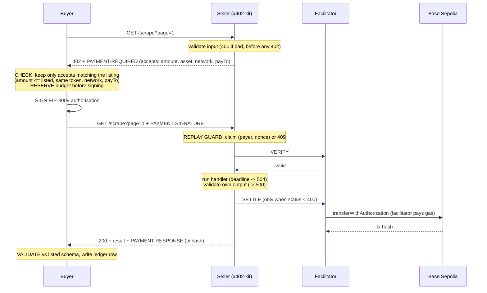

# Pay-per-call Agent Economy

A marketplace where AI agents hire other agents and pay **per request** in testnet USDC over **x402 v2** (HTTP `402 Payment Required`). No API keys, no subscriptions, no invoices, no human in the loop.

> **Testnet only.** Base Sepolia (`eip155:84532`). The network is a constant in the code, and every service refuses to start unless its RPC reports chain id 84532. No mainnet keys, funds or transactions anywhere in this project.

---

## Contents

- [The idea](#the-idea)
- [Build status](#build-status)
- [What's in the box](#whats-in-the-box)
- [Quick start](#quick-start)
  - [Fund the buyer (free, no financial value)](#fund-the-buyer-free-no-financial-value)
  - [Run the spike (first real paid call)](#run-the-spike-first-real-paid-call)
  - [Configuration (`.env`)](#configuration-env)
- [How a paid call works (x402 v2)](#how-a-paid-call-works-x402-v2)
- [Sellers](#sellers)
  - [Chaos fixtures (`cheap-scraper`)](#chaos-fixtures-cheap-scraper)
- [Registry](#registry)
  - [HTTP API](#http-api)
  - [Reputation](#reputation)
- [Buyer payment core (step 4)](#buyer-payment-core-step-4)
- [Buyer agent (step 5)](#buyer-agent-step-5)
  - [Choosing the seller: rules and fallback](#choosing-the-seller-rules-and-fallback)
  - [Example ledger](#example-ledger)
- [Payment safety](#payment-safety)
  - [Ledger statuses](#ledger-statuses)
  - [Reconciliation](#reconciliation)
  - [Ledger dashboard](#ledger-dashboard)
- [Interoperability](#interoperability)
- [Example tasks](#example-tasks)
- [Testing](#testing)
  - [Judge test pack (`npm run judge`)](#judge-test-pack-npm-run-judge)
- [Key hygiene](#key-hygiene)
- [Project layout](#project-layout)
- [Public URLs and wallets](#public-urls-and-wallets)
- [Rules this project follows](#rules-this-project-follows)
- [Roadmap (stretch goals)](#roadmap-stretch-goals)
- [Resources](#resources)
- [License](#license)

---

## The idea

A research agent, **Scout**, needs three things at 2 AM: book prices from a website it can't read, a currency rate, and a Hindi summary. Other agents can do each job, but none will work for free or sign a contract with software.

Scout finds them in a registry, pays a fraction of a cent per call, and guarantees that it:

- never pays twice for the same response,
- never pays more than the listed price,
- never spends more than its budget (even with parallel calls),
- never pays for garbage.

---

## Build status

| Step | What | State |
|---|---|---|
| 0 | Monorepo, shared types, exact USDC units, env, secret-redacting logs | Done |
| 1 | Spike: a stock `@x402/fetch` client pays our seller on Base Sepolia | Done (`npm run spike`; needs a funded buyer) |
| 2 | Seller kit (`packages/x402-kit`) + 3 sellers + chaos fixtures | Done |
| 3 | Registry: listings, validation, search API, reputation, web page | Done |
| 4 | Buyer payment core (`Buyer.payAndCall`): price check, budget, signing guard, on-chain resolution, signed ledger reports | Done (`npm run buy`) |
| 5 | Buyer agent (port 4200): task parser, plan + estimate, parallel executor with fallback, budget top-ups, explanation, console | Done |
| 6 | Ledger dashboard (live), on-chain reconciliation to the unit, wallets panel | Done (`/ledger`, `npm run reconcile`) |
| 7 | Judge test pack: every judged test, with stock-SDK reference sellers | Done (`npm run judge`) |
| 8 | Public HTTPS: gateway, base paths, deploy configure/check, Docker, tunnel configs | Done (`deploy/README.md`) |

---

## What's in the box

| Component | Role | Default port |
|---|---|---|
| **Registry** | Lists services; search by category, price and success rate (HTTP API + web page); computes reputation; **ledger dashboard** at `/ledger` | `4000` |
| **shelf-scraper** (scraping) | One catalogue page of `books.toscrape.com` per call, with each book's description | `4101` |
| **fx-rates** (data) | One currency pair per call (ECB reference rates) | `4102` |
| **hindi-summary** (inference) | Up to 2 texts per call, summarised in Hindi by Gemini | `4103` |
| **cheap-scraper** (test fixture) | Deliberately misbehaving seller: overpriced 402, wrong payTo, junk output, failure | `4199` |
| **Seller guild** (11 sellers) | `rich-shelf`, `book-inspector`, `fx-global`, `fx-trend`, `nvidia-hindi`, `openrouter-hindi`, `indic-translator`, `sentiment-tagger`, `text-insights`, `price-advisor`, `listing-auditor`: one process, each its own seller and wallet ([details](#seller-guild-11-more-sellers)) | `4111`–`4121` |
| **Buyer agent** (Scout) | Takes a task and a budget, plans, picks sellers, pays, validates, explains; console at `/` | `4200` |
| **Gateway** | One public port for everything (`/registry`, `/scraper`, `/fx`, `/summary`, `/chaos`, `/buyer`, and `/<id>` for each guild seller) | `8080` |

Every seller charges per request through HTTP 402 and settles in USDC on Base Sepolia. Every paid call ends in its own on-chain transfer with its own transaction hash.

---

## Quick start

**Prerequisites:** Node.js 22.13 or newer. Nothing else: SQLite is built into Node.

```bash
npm install
npm run wallets:new      # creates .env with fresh testnet wallets; prints public addresses only
npm start                # registry, all sellers, the buyer agent and the gateway: one command
```

Then open the marketplace at `http://localhost:4000`, the ledger at `http://localhost:4000/ledger` and the buyer console at `http://localhost:4200`. For public HTTPS, see [`deploy/README.md`](../deploy/README.md).

### Fund the buyer (free, no financial value)

1. `npm run wallets:new` printed a **BUYER** address. Get testnet USDC for it at the [Circle faucet](https://faucet.circle.com) (choose Base Sepolia): 20 USDC per address every 2 hours.
2. The buyer needs **no ETH**: the facilitator pays gas.
3. Check with `npm run wallets:balances`.

### Run the spike (first real paid call)

```bash
npm run spike                                         # pays fx-rates 0.001 USDC
npm run spike -- "http://localhost:4101/scrape?page=1"  # pays shelf-scraper 0.005 USDC
```

It prints the decoded `PAYMENT-REQUIRED`, pays with the **unmodified** `@x402/fetch` client, prints the `PAYMENT-RESPONSE` transaction with a Basescan link, and confirms on-chain that exactly the listed amount moved from the buyer to the seller's `payTo`.

### Configuration (`.env`)

`npm run wallets:new` fills in the wallets and the registry admin token. Everything else has defaults; see `.env.example` for the full list.

```ini
# Public addresses that RECEIVE payment (safe to publish). Sellers hold no private keys.
SCRAPER_PAY_TO=0x...
DATA_PAY_TO=0x...
INFERENCE_PAY_TO=0x...
CHAOS_PAY_TO=0x...
CHAOS_ALT_PAY_TO=0x...        # what the wrong-payto fixture advertises instead

# Secrets (testnet only, never commit)
BUYER_PRIVATE_KEY=0x...       # the ONLY key any service loads
REGISTRY_ADMIN_TOKEN=...      # lets our own sellers update their listings
GEMINI_API_KEY=...            # Hindi seller + buyer's task reader/narrative; without it /summarise answers 503
                              # (never charged) and the buyer reads tasks with its rules parser
SUMMARY_MODEL=gemini-3.5-flash-lite
BUYER_MODEL=gemini-3.5-flash-lite

# Public URLs (set to your https tunnel hostnames for judging)
SCRAPER_PUBLIC_URL=https://scraper.example.com
```

`.env` and `.secrets/` are git-ignored and created with mode 600. Only `.env.example` (no real values) is committed.

---

## How a paid call works (x402 v2)



**Where each step happens**

| Step | Where |
|---|---|
| Price / network / token / payTo check | Buyer, before signing. It filters the 402's `accepts` and refuses only if none matches the listing |
| Budget reservation | Buyer, before signing; synchronous, so parallel calls cannot overspend |
| Signing | Buyer, in process; the key never leaves it |
| Input validation | Seller, before the 402 |
| Replay check | Seller, before verification, keyed on (network, token, payer, nonce) |
| Verification | Facilitator, called by the seller before the handler runs |
| Service delivery and output self-validation | Seller, **before** settlement |
| Settlement | Facilitator, on-chain; the x402 v2 middleware settles only when the handler's status is below 400 |
| Result validation | Buyer, against the registry's output schema |

---

## Sellers

| Seller | Route | Price | Input | Output |
|---|---|---|---|---|
| shelf-scraper | `GET /scrape?page=N[&category=Travel]` | 0.005 (5000 units) | `page` 1–1000, optional category name or slug | `{ source, page, totalPages, hasNext, category, books: [{ title, priceGbp, rating, inStock, availability, url, upc, description }] }` |
| fx-rates | `GET /rate?from=GBP&to=INR` | 0.001 (1000) | two ISO 4217 codes | `{ from, to, rate, date, source, fetchedAt }` |
| hindi-summary | `POST /summarise` | 0.010 (10000) | `{ texts: [1..2], style: summary\|pitch\|guide, maxSentences: 1..5 }` | `{ language: "hi", style, model, results: [{ index, text }] }` |

Each seller also serves `GET /health` and `GET /listing` (free).

**No service, no charge, in practice:**

| What goes wrong | Response | Settled? |
|---|---|---|
| Malformed input | `400 invalid_input` (before any 402) | Nothing to settle |
| Same payment presented again (sequential or parallel) | `409 payment_already_used` | No; the handler never runs |
| Page or category doesn't exist | `404` | No |
| Unsupported currency | `422 unsupported_currency` | No |
| Upstream site or model unavailable | `502` / `503` | No |
| Handler too slow | `504 handler_timeout` | No |
| Output breaks the seller's own schema (including a "Hindi" summary that isn't in Devanagari) | `500 output_failed_self_check` | No |

### Seller guild (11 more sellers)

`apps/sellers/guild` runs 11 more seller agents in one process (`npm run start:guild`, included in `npm start`). Each is a separate seller: its own `sellerId`, `payTo` wallet (`<NAME>_PAY_TO`, filled by `npm run wallets:new`), port (`GUILD_BASE_PORT` 4111 + position) and listing. The roster lives in `apps/sellers/guild/src/roster.ts`; the gateway, `deploy:configure`, `deploy:check` and the wallet script all read it. Every answer is checked before it is sold, so a bad one is a 4xx/5xx and is never charged.

| Seller | Route | Price | What it adds | Scout uses it? |
|---|---|---|---|---|
| rich-shelf | `GET /scrape?page=N[&category=]` | 0.006 | shelf-scraper's page **plus** each book's exact stock count, review count, own category and cover image | Yes: same input, superset output (fallback for book pages) |
| book-inspector | `GET /inspect?url=<product page>` | 0.002 | Everything one product page shows: UPC, prices excl./incl. tax, stock count, reviews, category, description, image | No (new capability) |
| fx-global | `GET /rate?from=GBP&to=AED` | 0.0015 | 166 currencies from ExchangeRate-API's open feed (ECB data has 30; no AED, SAR, PKR, NGN...) | Yes: same contract as fx-rates (fallback, and the only one for non-ECB currencies) |
| fx-trend | `GET /trend?from=GBP&to=INR[&days=30]` | 0.002 | Latest ECB rate plus 7-90 day min, max, mean and % change | Yes: its answer includes `rate` |
| nvidia-hindi | `POST /summarise` | 0.010 | Hindi summaries with NVIDIA Nemotron (Ultra, falling back to Super) | Yes: same contract as hindi-summary |
| openrouter-hindi | `POST /summarise` | 0.012 | Hindi summaries via OpenRouter (DeepSeek V4 Flash, falling back to Mistral Small) | Yes: same contract as hindi-summary |
| indic-translator | `POST /translate` | 0.008 | Translation into hi, mr, bn, pa, gu, ta, te, kn, ml or ur (OpenRouter); output checked to be in the target script | No (new capability) |
| sentiment-tagger | `POST /analyse` | 0.006 | Per text: sentiment, score -1..1, tone, genre tags, audience (NVIDIA Nemotron) | No (new capability) |
| text-insights | `POST /analyse` | 0.001 | Deterministic (no LLM): words, sentences, reading time, Flesch reading ease, script, RAKE keyphrases | No (new capability) |
| price-advisor | `GET /advise?category=scraping` | 0.001 | **For sellers:** a competitive price from live registry data (competitors' prices, success rates, cost per good result), with reasons | No (helps sellers) |
| listing-auditor | `POST /audit` `{ listing }` | 0.005 | **For sellers:** runs the registry's own acceptance rules on a draft listing, checks the id is free, compares the price, flags weak schemas, adds AI suggestions and a rewritten description | No (helps sellers) |

Because the five drop-in sellers share a contract with an existing one, Scout's rules (R1-R8) now have real choices: an incumbent that fails, refuses or is struck in a task falls back to the next seller instead of leaving a gap. Prices are set at or above the incumbents, so estimates stay the same unless reputation changes the ranking.

LLM providers (server-side only): `NVIDIA_API_KEY` / `NVIDIA_MODELS` and `OPENROUTER_API_KEY` / `OPENROUTER_MODELS` (comma-separated, tried in order). Without a key, the sellers that need it answer 503 and are never charged; `listing-auditor` still returns its rule-based audit.

### Chaos fixtures (`cheap-scraper`)

Flagged `isFixture` and hidden from default search (`includeFixtures=true` shows them). They recreate the judges' reference sellers so every buyer safety check can be demonstrated live:

| Listing id | Route | Behaviour |
|---|---|---|
| `cheap-scraper` | `/honest/scrape` | Honest, 0.002 (control) |
| `cheap-scraper-overprice` | `/overprice/scrape` | Listed 0.002, 402 asks 0.020 |
| `cheap-scraper-wrong-payto` | `/wrong-payto/scrape` | 402 names `CHAOS_ALT_PAY_TO` instead of the listed payTo |
| `cheap-scraper-junk` | `/junk/scrape` | 200 with schema-breaking output, and settles |
| `cheap-scraper-fail` | `/fail/scrape` | Fails after verification; never settles |

---

## Registry

Sellers list services with: `id`, `sellerId`, `name`, `category` (`data` | `inference` | `scraping`), `endpoint`, `method`, `price` (USDC) or `priceUnits`, `network`, `asset`, `payTo`, `inputSchema`, `outputSchema`, `description`.

**Registration rules:** https endpoint (http only for localhost in development), price above 0 and at most 0.10 USDC, network `eip155:84532`, asset Base Sepolia USDC, a valid payTo, and schemas that compile (draft-07 or 2020-12). Public registrations are **insert-only**, so nobody can overwrite an existing listing's payTo. Our own sellers update theirs with `REGISTRY_ADMIN_TOKEN`.

### Storage: SQLite plus MongoDB Atlas

The registry keeps its data in a local SQLite file (`.data/registry.db`) for fast, synchronous reads. With `MONGODB_URI` set, **MongoDB Atlas holds a durable cloud copy of every table**:

| Atlas collection | What | Written by |
|---|---|---|
| `services` | Every listing (registrations, admin and public) | registry |
| `users` | Portal registrations | registry |
| `sessions` | Buyer sessions (start block, buyer wallet) | registry |
| `ledger` | Every transaction: pending, paid, refused, failed, with tx hash and on-chain confirmation; amounts as exact strings | registry |
| `auth_sessions` | Google sign-in sessions, stored as SHA-256 of the token (expired ones are deleted by a TTL index) | registry |
| `tasks` | Scout's task history: the full task view and event log, so finished tasks survive restarts | buyer agent |

How the registry stays in sync: SQLite triggers write each change into an outbox table in the same transaction, and a background loop pushes the outbox to Atlas with idempotent upserts. If Atlas is unreachable, changes wait in the outbox (even across restarts) and are delivered when it is back. The first run against a database uploads everything once; a registry that starts with an **empty** local database (new machine, container or deploy) **restores everything from Atlas** before serving. `GET /api/health` shows the state (`storage.atlas.pendingWrites`).

Not in Atlas, on purpose: each seller's payment replay store (`.data/<seller>-nonces.db`) stays local, because it must be atomic and instant to stop a payment being used twice. Use one `MONGODB_DB` per deployment (two registries sharing a database would overwrite each other's listings).

### HTTP API

| Method | Path | Description |
|---|---|---|
| `GET` | `/api/services` | Search. Filters: `category`, `maxPrice` (USDC) or `maxPriceUnits`, `minSuccessRate` (0–1), `q`, `includeFixtures`; `sort` = `score` \| `price` \| `latency` \| `successRate` \| `name` |
| `GET` | `/api/services/:id` | One listing, with schemas and reputation |
| `POST` | `/api/services` | Register a service |
| `DELETE` | `/api/services/:id` | Remove (admin token) |
| `GET` | `/api/sellers/:id/reputation` | Success rate, median latency, price, per-service breakdown |
| `GET` | `/api/ledger` | Every attempted call (`sessionId`, `status`, `serviceId`, `limit`) |
| `POST` | `/api/ledger` | Buyer reports a row, **signed by its wallet** (EIP-191); upserted only along legal transitions |
| `POST` | `/api/sessions` | Buyer session (signed), with the start block for reconciliation |
| `GET` | `/api/sessions/:id` | Session plus exact totals (paid units, calls by status) |
| `GET` | `/api/meta` | Network, asset, explorer and facilitator config |

```bash
curl "http://localhost:4000/api/services?category=scraping&maxPrice=0.005"

curl -X POST http://localhost:4000/api/services -H 'content-type: application/json' -d '{
  "id": "my-fx", "name": "my-fx", "category": "data", "description": "FX rates",
  "endpoint": "https://my-fx.example.com/rate", "method": "GET", "price": "0.001",
  "payTo": "0xYourAddress", "inputSchema": {"type": "object"}, "outputSchema": {"type": "object"}
}'
```

### Reputation

Each service shows **success rate**, **median latency** and **price**. Success rate uses a Beta(2,1) prior over the last 200 calls, so a new seller starts at 66.7% (neither trusted blindly nor locked out) and a seller that starts returning junk drops quickly. A refusal caused by the buyer's own budget doesn't count against the seller; refusals for overpricing or a wrong payTo do. Default ranking is **price ÷ success rate** (expected cost per good result), with median latency as the tiebreak.

---

## Buyer payment core (step 4)

`packages/x402-kit` exports `Buyer`, `Budget` and the ledger sinks. One call:

```ts
const buyer = new Buyer({ account, ledger: [new MemoryLedger(), new RegistryLedgerSink(registryUrl, account)] });
const budget = new Budget(toUnits("0.050"));
const out = await buyer.payAndCall({ listing, input: { page: 1 }, budget });
out.row.status;   // paid | paid_output_rejected | refused | failed_not_charged | pending
out.output;       // set only when the result passed the listed output schema
await out.finalized; // final row once the chain has confirmed it
```

| Step | What happens |
|---|---|
| 1. Unpaid call | Read the 402 |
| 2. Price check | Keep only `accepts` matching the listing (scheme `exact`, network, token, payTo, amount ≤ listed, sane time window). None left: **refused**, nothing signed |
| 3. Budget | Reserve the asked amount synchronously; doesn't fit: **refused** (`budget`), with how much is free |
| 4. Sign | EIP-3009 for exactly the approved option. A signing guard aborts anything else, signing is registered for Base Sepolia only, and SDK spend controls cap one payment at 0.10 USDC |
| 5. Paid call | Retry with `PAYMENT-SIGNATURE`; the row is recorded as `pending` (with its nonce) *before* the payment leaves the process |
| 6. Classify | Settled: commit, validate output: **paid** or **paid_output_rejected**. Explicit error: **failed_not_charged**, reservation held until the authorisation expires and the chain shows it unused. No answer or no receipt: **pending**, polled on-chain (`authorizationState`, tx recovered from `AuthorizationUsed`) |
| 7. Confirm | Every paid receipt is checked for exactly `amount` buyer → payTo |

A seller that reports failure but settles anyway is caught (`settled_despite_error`), and the budget still never goes over, because the reservation was never released.

```bash
npm run buy -- fx-rates '{"from":"GBP","to":"INR"}'
npm run buy -- cheap-scraper-overprice '{"page":1}'                       # refused: 10x the listed price
npm run buy -- shelf-scraper '{"page":1}' --budget 0.012 --repeat 4 --concurrency 5
```

## Buyer agent (step 5)

Give it a task in plain language and a budget:

```bash
curl -X POST http://localhost:4200/api/tasks \
  -H "Content-Type: application/json" -H "Authorization: Bearer $BUYER_API_TOKEN" \
  -d '{
    "task": "From pages 1 to 4 of books.toscrape.com, find the three cheapest 5-star books, give their prices in rupees, and summarise each description in Hindi.",
    "budget": "0.050",
    "max_concurrency": 3
  }'
# -> { "taskId": "task_…", "events": "/api/tasks/task_…/events" }
curl http://localhost:4200/api/tasks/task_…          # understanding, estimate, steps, answer, explanation, ledger
curl -N http://localhost:4200/api/tasks/task_…/events # live Server-Sent Events
```

| Option | Meaning |
|---|---|
| `budget` | USDC, e.g. `"0.050"` (at most `BUYER_MAX_TASK_BUDGET`, default 0.50) |
| `max_concurrency` | Paid calls in flight at once, 1–10 (default 3) |
| `on_short_budget` | `"partial"` (default): buy what fits, then report the shortfall. `"ask"`: if the estimate is over budget, ask before buying anything |
| `dry_run` | Parse and estimate only; `POST /api/tasks/:id/start` runs it |
| `prefer_sellers` / `only_sellers` | Service ids to try first / to restrict to (per category). Test fixtures are only used when named here |

**How it works**

1. **Understand.** The task becomes a structured `TaskSpec` (pages or categories, rating filter, selection or per-category comparison, currencies, Hindi text style). Gemini reads it through a JSON schema (structured output) when `GEMINI_API_KEY` is set. A deterministic rules parser always runs: it is the fallback, and if the two readings differ the buyer says so. Changed numbers ("pages 2 to 7", "five", "4-star", "yen") change the spec, never the code.
2. **Plan and estimate** with each step's best compatible seller, before any money moves. Text is batched to the seller's limit (2 per call), as in the brief's 0.041 example. Unknown page counts make the estimate a stated lower bound.
3. **Choose sellers** with the eight selection rules below. Every purchase in the explanation names the rule that chose it.
4. **Buy, in parallel.** Up to `max_concurrency` paid calls run at once. Scraping and FX run concurrently; "every page" sources fan out once page 1 reveals the count.
5. **Fall back** down the fallback ladder below. A seller that fails is struck or skipped according to what it did.
6. **Budget.** If a call doesn't fit while money is only *held* by an unsettled failure, the buyer waits for it to be released. Otherwise it stops, gives a partial answer, and reports exactly what is missing ("Top up at least 0.009 USDC to finish: …"). `POST /api/tasks/:id/topup {"amount":"0.009"}` resumes it; nothing already bought is bought again.
7. **Explain** what was bought, from whom, why that seller and at what cost. This is built from the ledger rows and the executor's recorded decisions, not from model text. An optional Gemini narrative retells it from that record.
8. **The buyer's own problems are not blamed on sellers.** An empty wallet stops the task before anything is bought, and a payment the facilitator rejects for insufficient balance halts it without striking anyone.

### Choosing the seller: rules and fallback

For every purchase, `apps/buyer/src/selection.ts` applies these rules in order and records which rule kept, ranked or dropped each seller.

| # | Rule | Kind | What it does |
|---|---|---|---|
| R1 | **Caller intent** | hard | `only_sellers` restricts a category; `prefer_sellers` are tried first; test fixtures are used only when named |
| R2 | **Contract fit** | hard | Right category; the seller's `inputSchema` must accept our request (checked with Ajv); its `outputSchema` must promise the fields we need (a preferred seller is checked on arrival instead) |
| R3 | **Safe listing** | hard, never relaxed | Base Sepolia, testnet USDC, price within the 0.10 cap, a real payTo that is not the buyer's own wallet, an https endpoint (http only on loopback). This repeats the registry's checks in case the registry is wrong |
| R4 | **Affordability** | soft | A seller that can never fit the budget is skipped. "Fits once held money is released" ranks after "fits now" |
| R5 | **Fair price** | soft | More than 3× the median price of the *usable* sellers (trusted, affordable, not cooling down) is skipped while a fairly priced one exists |
| R6 | **Trust floor** | soft | With ≥ 5 calls of evidence, < 50% success excludes. 3 failures in a row means a cool-down (ranked last). A strike earlier in this task excludes |
| R7 | **Best value** | score | Expected cost per good result = price ÷ P(success), plus 0.0001 USDC per second of median latency. P(success) is the reputation's Beta posterior minus one standard deviation, so thin evidence counts for less: one success beats none, fifty beat one, and a much cheaper newcomer still gets a chance |
| R8 | **Spread near-ties** | tie-break | Parallel steps (pages, batches) rotate across sellers scoring within 10% of the best, so four pages don't all queue on one seller |

Caller-preferred sellers are exempt from R5 and R6: the caller asked for them, so the rule is noted rather than applied. Thresholds can be tuned through `MarketOptions.selection`.

**Fallback ladder**, used when the chosen seller does not deliver or nobody passes every rule:

1. **Next-ranked seller.** The failed one is struck for the task if it was dishonest (overpriced or wrong-payTo 402, schema-breaking output, settling after claiming failure). It is skipped for this step only after an operational failure, and struck after a second. A "no such page" error never counts against it.
2. **Relax the soft rules** (R4–R6), never R1–R3, when no seller passes every rule. The relaxed rule is named in the log and the explanation.
3. **Budget.** Wait while money is only held by an unsettled payment; otherwise stop, keep the partial answer, and report the exact top-up needed.
4. **Probe unproven sellers** one call at a time until they deliver, so a bad newcomer costs at most one payment.
5. **Give up gracefully.** If no seller can deliver a step, the answer names the gap and the task ends `partial`.

**Statuses:** `parsing` → `planning` → (`planned`) → `running` → `completed` | `partial` (no seller could deliver some step) | `needs_budget` | `failed` | `cancelled`. `settled: true` once every payment is final on-chain and the ledger is in the registry.

### Example ledger

| # | Call | Listed | Asked | Paid | Status |
|---|---|---|---|---|---|
| 1 | cheap-scraper-overprice, page 1 | 2000 | 20000 | 0 | Refused: asked 10x its listed price |
| 2-5 | shelf-scraper, pages 1-4 | 5000 each | 5000 each | 20000 | Paid, 4 transactions |
| 6 | fx-rates, GBP to INR | 1000 | 1000 | 1000 | Paid |
| 7-8 | hindi-summary, 3 descriptions in 2 calls | 10000 each | 10000 each | 20000 | Paid, 2 transactions |

Total paid: 41000 units (0.041 USDC), leaving 0.009. Amounts are in USDC's smallest unit (6 decimals: `1000` = 0.001 USDC).

---

## Payment safety

| Guarantee | How it works |
|---|---|
| **Budget** | The buyer reserves the price before signing. The reservation is a synchronous check-and-add, so parallel calls cannot overspend at any `max_concurrency`, and it is released only when money provably cannot move. When funds run out, it stops and says why (or asks for more). |
| **Price check** | The buyer keeps only the 402 `accepts` entries that match the listing exactly (amount ≤ listed, same token, network and `payTo`) and refuses if none remain. Nothing is signed and nothing is paid. |
| **Replay** | One authorisation unlocks one response. The seller claims `(network, token, payer, nonce)` with a single SQLite insert before verification; repeats, sequential or parallel, get `409` and the handler never runs. |
| **No service, no charge** | The seller verifies, runs the handler under a deadline, and validates its own output **before** settling. Any failure is a status ≥ 400, and the x402 v2 middleware never settles those. |
| **Bad output** | The buyer validates every response against the listed schema. Junk is recorded as *paid, output rejected*, is never used, lowers the seller's reputation, and triggers a purchase from another seller if the budget allows. |
| **Unclear outcome** | If the payment was signed and sent but no clear answer came back, the buyer holds the reservation until the authorisation expires, then reads USDC's `authorizationState(buyer, nonce)` on-chain to settle the ledger row. |

### Ledger statuses

`paid` | `paid_output_rejected` | `refused` | `failed_not_charged`, plus `pending` while an unclear outcome is being decided on-chain.

Each row records: time, buyer, seller, service, endpoint, payTo, listed price, asked price, amount paid, transaction hash with explorer link, status, a machine-readable reason code and a human reason, the authorisation nonce and expiry, HTTP status, latency, and whether the chain confirms the row. Rows are signed by the buyer wallet, kept in the registry, and appended to `.data/ledger/<session>.jsonl`.

**Reputation counts only what the seller controls.** Refusals for the buyer's own budget and payments the facilitator rejected for the buyer's balance don't count against the seller; overpriced or wrong-payTo 402s, errors, junk and timeouts do.

### Reconciliation

`GET /api/ledger/reconcile?sessionId=…` (the **Reconcile** button on `/ledger`, or `npm run reconcile -- <sessionId>`) scans every USDC transfer out of the buyer wallet from the session's start block to now. Base Sepolia's public RPC allows only 200 blocks per `eth_getLogs` call, so the scan runs in windows. It then checks, to the last unit:

| Issue | Meaning |
|---|---|
| `missing_on_chain` | a paid row has no transfer from the buyer in its transaction |
| `missing_in_ledger` | money left the wallet with no ledger row explaining it |
| `amount_mismatch` / `payto_mismatch` | the transfer moved a different amount, or went somewhere else |

Totals must match exactly (`diffUnits` 0). Rows from an earlier session whose payment landed in range are accounted for, and the session's own subtotal is shown too. Scanned blocks are cached, except the last 5 below the head, which are rescanned every time in case of a reorg.

### Ledger dashboard

`/ledger` on the registry shows every attempted call live (Server-Sent Events): time, buyer, seller and service, listed, asked and paid amounts, transaction link (✓ when the receipt was checked), status with reason, and latency. It has filters by session, status and service, totals, one-click reconciliation, and a wallets panel with USDC balances for every buyer and payTo the registry knows.

---

## Interoperability

- Sellers use the standard `@x402/express` v2 middleware, so an **unmodified x402 v2 client** can pay them. Proven offline in `tests/unit/seller.test.ts` and live by `npm run spike`.
- The buyer uses the standard x402 v2 client SDK, so it can pay an **unmodified x402 v2 seller**.

---

## Example tasks

Each task needs all three categories (scraping, data, inference).

1. **Books to rupees, in Hindi.** Pages 1-4 of `books.toscrape.com`: the three cheapest 5-star books, prices in INR, Hindi summaries. About 0.041 USDC.
2. **Travel pitches.** The 4 most expensive books in the Travel category, priced in EUR and JPY, with a one-line Hindi pitch each. About 0.027 USDC.
3. **Genre buying guide.** Average price of Mystery vs Historical Fiction books in USD, INR and EUR, plus a short Hindi buying guide. About 0.033 USDC.

---

## Testing

```bash
npm run check             # type-check + offline tests (no funds or network needed)
npm run test:replay       # live: one signature x2, then x5 in parallel -> one result, one transfer each
npm run test:failure      # live: unfulfillable requests -> error, authorisation unused on-chain
npm run test:buyer        # live: happy path, price check, junk, failure, budget at concurrency 1 and 5, reconciliation
npm run judge             # the judges' test pack (below); report in .data/judge/
npm run deploy:check      # the deployment as a judge meets it (deploy/README.md)
```

The offline suite (`tests/unit`) runs real HTTP against the seller kit with real EIP-3009 signatures from the stock x402 client and an in-process facilitator. It covers the 402 shape, input errors before payment, replay (sequential, parallel, cross-route), timeouts, self-validation, failed verification, fixtures and interop with `wrapFetchWithPayment`; the buyer against our sellers and an **unmodified `@x402/express` seller** (price check, junk, failures held until expiry, a seller that settles after claiming failure, lost responses and missing receipts resolved on-chain, budget at concurrency 1 and 5); the registry's validation, search, reputation and signed ledger ingestion (forged, tampered, inconsistent and illegal-transition rows are rejected); and the buyer agent end to end on an in-process marketplace built with the real seller schemas. That covers the three example tasks and changed numbers, with answers checked against independently computed expectations; junk, overpriced, wrong-payTo and flaky sellers; the 0.012 budget test at concurrency 1 and 5 plus a top-up that never re-buys; ask mode; dry runs; parser variations; the HTTP API (auth, SSE); and an empty or underfunded wallet.

### Judge test pack (`npm run judge`)

Runs every judged test against the live stack on Base Sepolia and writes a Markdown report with explorer links (about 0.08 testnet USDC). Reference sellers are started from the **stock `@x402/express` SDK** against the real x402.org facilitator (honest, overpriced, wrong payTo, junk), registered for the run, and removed afterwards.

| Check | What it does |
|---|---|
| `happy` | One of our tasks with changed numbers through the buyer agent; ≥ 3 paid calls; every receipt checked buyer → payTo for the exact amount |
| `reconcile` | That session's ledger vs the chain, to the unit |
| `budget` | 0.012 USDC for a 0.021 task at concurrency 1 and 5; ledger and wallet both ≤ 0.012; the buyer says why it stopped |
| `price` | Reference sellers listed at 0.001 whose 402 asks 0.010 / names another payTo: refused, wallet unchanged |
| `replay` | One signature twice, then 5× in parallel against our seller: one result and one transfer each |
| `failure` | Unfulfillable requests: error, and the authorisation is unused on-chain |
| `junk` | A reference seller returns schema-breaking output: paid, output rejected, unused, reputation lowered, bought elsewhere |
| `standard` | Stock `@x402/fetch` pays our seller; our buyer pays the stock reference seller |
| `hygiene` | gitleaks if installed, plus an exact-value scan for every secret this deployment holds, across the git history, every committable file, the web bundle and the logs |

Without funds, the payment checks report SKIP with the reason. The price check still runs, through the buyer's payment core, because it refuses before paying. Hygiene runs either way.

| Scenario | Expected result |
|---|---|
| Seller lists 0.001 but its 402 asks 0.010 | Buyer refuses, nothing paid |
| Seller's 402 names a different `payTo` | Buyer refuses, nothing paid |
| Same signed payment sent twice, then 5 times in parallel | Exactly one paid result per signature, exactly one on-chain transfer |
| Request the seller can't fulfil | Error returned, nothing transferred |
| Seller returns 200 with schema-breaking output | *paid, output rejected*; reputation lowered; buyer buys elsewhere |
| Budget 0.012 USDC for a ~0.02 task, `max_concurrency` 1 and 5 | Spend never exceeds 0.012; buyer stops or asks for more, saying why |

---

## Key hygiene

- **Only the buyer holds a private key.** Sellers need only a public `payTo`, because the facilitator pays gas. Seller wallet keys created by `wallets:new` go to `.secrets/` (git-ignored, mode 600) for sweeping testnet funds back; no service loads them.
- `.env` is git-ignored and created with mode 600.
- Logs pass through a redactor that removes the value of every secret environment variable, 65-byte signatures (an unused EIP-3009 authorisation can be replayed, so it's treated as a secret), Google (Gemini) and Anthropic API keys, and bearer tokens. Transaction hashes and addresses are public and stay visible.
- The browser pages receive only public data (addresses, hashes, amounts).
- Use fresh testnet wallets only. If a key ever leaks, the wallet is burned: create a new one and move the funds.

---

## Project layout

```
.
├── apps/
│   ├── buyer/                 buyer agent: parser, planner, executor, report, API + console (public/)
│   ├── gateway/               one public port: path prefixes -> services (SSE-safe, keeps the public Host)
│   ├── registry/              registry API, reputation, ledger store, marketplace page (public/)
│   └── sellers/
│       ├── scraper/           shelf-scraper (scraping)
│       ├── data/              fx-rates (data)
│       ├── inference/         hindi-summary (inference, Gemini)
│       └── chaos/             cheap-scraper test fixtures
├── packages/
│   ├── shared/                constants, units, types, env, logging, JSON Schema, SQLite
│   └── x402-kit/              seller kit (input check, replay guard, x402, deadline, self-check), chain reads
├── scripts/                   wallets, balances, spike
├── tests/
│   ├── unit/                  offline suite (mock facilitator)
│   ├── live/                  live Base Sepolia tests (funded buyer)
│   └── judge/                 the judges' test pack + stock-SDK reference sellers + key-hygiene scan
├── docs/                      PRD, this README, x402 notes
├── deploy/                    deployment guide, cloudflared + Caddy examples
├── Dockerfile, docker-compose.yml
├── .env.example
└── package.json               workspaces + one-command start
```

---

## Public URLs and wallets

Fill these in before judging: `npm run deploy:check` prints this table with your real URLs (`.data/deploy/public-urls.md`). Sellers and the registry must stay reachable over public HTTPS throughout; see [`deploy/README.md`](../deploy/README.md).

| Service | URL |
|---|---|
| Registry + marketplace | `https://...` |
| shelf-scraper | `https://...` |
| fx-rates | `https://...` |
| hindi-summary | `https://...` |
| cheap-scraper (fixtures) | `https://...` |
| Buyer agent | `https://...` |

| Wallet | Address (Base Sepolia) |
|---|---|
| Buyer | `0x...` |
| shelf-scraper `payTo` | `0x...` |
| fx-rates `payTo` | `0x...` |
| hindi-summary `payTo` | `0x...` |
| cheap-scraper `payTo` | `0x...` |

Explorer: <https://sepolia.basescan.org>

---

## Rules this project follows

- Testnets only; any mainnet transaction is a disqualification.
- x402 v2 for every judged test.
- At most 0.10 USDC per call (enforced at registration and at seller start-up).
- Scraping only `books.toscrape.com`, respecting `robots.txt`, with an honest User-Agent and capped concurrency.
- Facilitator: `https://x402.org/facilitator` (testnet), configurable via `FACILITATOR_URL`.

---

## Roadmap (stretch goals)

- [ ] Agent chain: a seller that hires other sellers and pays them from what it earns
- [ ] Paid MCP tools or the A2A x402 extension
- [ ] Listing via the x402 Bazaar discovery extension
- [ ] Metered pricing for inference (the x402.org facilitator already supports the `upto` scheme on Base Sepolia)
- [ ] Spending policies per seller or category, with human approval above a threshold
- [ ] Escrow or refunds for disputed calls
- [ ] Second network (Solana Devnet)

---

## Resources

- [x402 repository and SDKs](https://github.com/coinbase/x402)
- [x402 docs](https://docs.x402.org)
- Base Sepolia: chain ID `84532`, RPC `https://sepolia.base.org`
- Testnet USDC (Base Sepolia): `0x036CbD53842c5426634e7929541eC2318f3dCF7e`
- [Circle faucet](https://faucet.circle.com)
- [toscrape.com](https://toscrape.com): sandbox sites built for scraping

## License

Apache-2.0.
